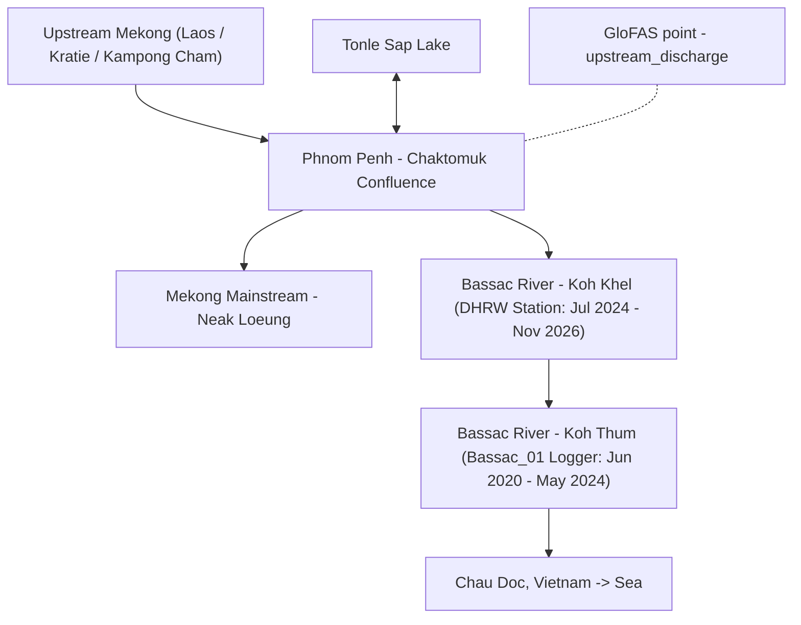
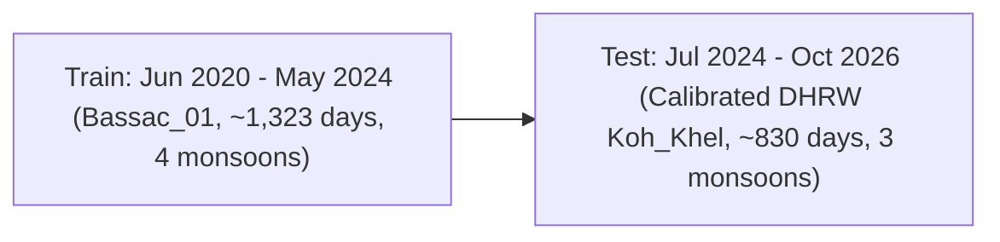

# Bassac River Water Level Forecasting — Learning Guide

> **Project in one sentence:**
> Predict **tomorrow's** daily water level of the Bassac River in Kandal Province (`KH08`), Cambodia across **2020–2026** by combining **2020–2024 Bassac logger data (`Bassac_01_ori.csv`)** with **calibrated 2024–2026 DHRW Koh Khel data (`dhrw_water_level_2020_2026.csv`)**, plus **Kandal rainfall** and **upstream river discharge (`upstream_discharge`)**.

---

## Part 0 — Project at a glance

| Question | Answer |
|---|---|
| **What do we predict?** | Bassac River daily water level, **1 day ahead (`WL_next`)** |
| **Unit** | Metres above sea level (`Bassac_01` Ha Tien datum) |
| **Where?** | Lower Bassac River in Kandal (`KH08`): Koh Thum (`2020–2024`) + calibrated Koh Khel (`2024–2026`) |
| **Full timeline** | **19 Jun 2020 → 11 Nov 2026** |
| **Total water-level days** | **2,182 days** (`1,331 days` from `Bassac_01` + `851 days` from DHRW `Koh_Khel` in Jul 2024 – Nov 2026) |
| **Why combining works** | Across 645 shared days (2020–2023), `Bassac_01` and `Koh_Khel` move together with **$r = 0.9957$ ($R^2 = 0.9915$)** |
| **Inputs (X) — 11 features** | **5 water-level features** + **4 Kandal (`KH08`) rainfall features** + **2 upstream discharge features** |

**Key purpose**
- Build a beginner-friendly, end-to-end 2020–2026 ML workflow: collect → calibrate & merge → prevent cheating (leakage) → train → evaluate → explain.
- Test whether past water levels, rainfall, and upstream flow beat a simple "tomorrow = today" guess.

---

## Part 1 — The real-world problem

### 1.1 The river network
- The **Mekong River** flows: China → Laos → Cambodia → Vietnam → sea.
- At **Phnom Penh (Chaktomuk)** it splits into two branches: the Mekong mainstream and the **Bassac River** (western branch).
- The Bassac flows south through **Kandal (`KH08`)**, passing **Koh Khel** and **Koh Thum** (~15 km apart) before entering Vietnam.

**Why this matters:** Water passing Phnom Penh reaches Koh Khel and Koh Thum 1–2 days later, giving early warning before the flood wave arrives in Kandal.

### 1.2 Why the water level changes

| Season | Months | What happens | Water Level (`Bassac_01` scale) |
|---|---|---|---|
| Dry | Dec – May | Little rain; sea tide pushes up twice a day | ~1.3–1.8 m (tide moves it ~0.7 m/day) |
| Rising | Jun – Aug | Monsoon rain upstream; river swells | rises fast |
| Peak | Sep – Oct | Maximum flood | ~4.5–5.3 m |
| Falling | Nov – Dec | Rain stops; water drains | drops |

**Key idea**
- Most Bassac water comes from **upstream along the Mekong**, while rain falling directly on Kandal adds a smaller boost.
- That is why **past water level** and **upstream flow (`upstream_discharge`)** are the strongest predictors.

### 1.3 Why forecasting matters
- **Farmers** time rice planting and harvest around the annual flood.
- **Early warning:** Knowing tomorrow's water height helps communities prepare.
- **Changing river:** Upstream dams and climate change make old seasonal averages less reliable, so ML models help.

---

## Part 2 — The four datasets

### 2.1 Dataset 1: Bassac Water Level 2020–2024 (`Bassac_01_ori.csv`) — TARGET (Part 1)

| Item | Value |
|---|---|
| File | `Bassac_01_ori.csv` |
| Role | **Target & Historical Water Level (19 Jun 2020 → 26 May 2024)** |
| Location | Bassac River at Koh Thum, Kandal (`11.05 N, 105.07 E`) |
| Recorded by | Institute of Technology of Cambodia (ITC) & IRD / UMR G-EAU (France) |
| Columns | `Date` (`dd/mm/yyyy HH:MM`), `WL` (m above sea level, Ha Tien datum) |
| Frequency | Every 15 minutes → averaged to **1 value per day** (`1,331 valid days`, `107 missing days`) |
| Citation | Massuel, S. et al. (2024). *Water Level Data from the Prek System of the Cambodian Mekong Delta (2020–2024)*. DataSuds (IRD). https://doi.org/10.23708/E97HGV |

### 2.2 Dataset 2: DHRW Koh Khel Water Level 2024–2026 (`dhrw_water_level_2020_2026.csv`) — TARGET (Part 2)

| Item | Value |
|---|---|
| File | `dhrw_water_level_2020_2026.csv` |
| Role | **Extended Target & Recent Water Level (1 Jul 2024 → 11 Nov 2026)** |
| Station used | **`Koh_Khel`** only (Bassac River in Kandal, station `033402`). The other 6 river columns are dropped. |
| Recorded by | Department of Hydrology and River Works (DHRW), MOWRAM Cambodia (https://dhrw-cam.org/bulletintbl.php) |
| Frequency | Daily at 07:00 AM |
| Rows used | **851 continuous year-round days (`2024-07-01` → `2026-11-11`)** after `Bassac_01` ends (2020–2023 shared rows are used only to fit the calibration formula). |

### 2.3 Dataset 3: Kandal Rainfall (`khm-rainfall-subnat-full.csv`) — FEATURE

| Item | Value |
|---|---|
| File | `khm-rainfall-subnat-full.csv` |
| Source | WFP / HDX (CHIRPS satellite + rain gauges), https://data.humdata.org/dataset/khm-rainfall-subnational |
| Frequency | **Dekad** = 10-day period (`1st`, `11th`, `21st` of each month), Jan 1981 → Oct 2026 |
| Filter used | `adm_level == 1`, `PCODE == "KH08"` (Kandal Province), `version != "prelim"` |
| Columns used | `rfh` (10-day rain mm), `r1h` (1-month rain mm), `r3h` (3-month rain mm), `rfq` (rain % of normal) |

### 2.4 Dataset 4: Upstream Discharge (`glofas_discharge_phnompenh.csv`) — FEATURE

| Item | Value |
|---|---|
| File | `glofas_discharge_phnompenh.csv` |
| Column | Raw `Q` → renamed to **`upstream_discharge`** (`m³/s` = cubic metres of water flowing per second) |
| Location | Grid cell at Phnom Penh (`11.525 N, 104.925 E`), ~55 km upstream of Koh Khel & Koh Thum |
| Range | 1 Jan 2018 → 9 Nov 2026 (daily) |
| Source | Copernicus GloFAS via Open-Meteo Flood API (https://open-meteo.com/en/docs/flood-api), correlation **$r = 0.85$** with Bassac WL |

**What `upstream_discharge` (symbol Q) means in simple words**
- $1\text{ m}^3 \approx 1,000\text{ litres}$ (one big water tank).
- `upstream_discharge = 4,120` → ~4,120 tanks of water flow past Phnom Penh every second.
- Formula: $\text{Q} = \text{river cross-section area} \times \text{water speed}$.

---

## Part 3 — Extending 2020–2024 to 2026 (Option B: Station Calibration & Simple Math)

### 3.1 Why we combine `Bassac_01` (2020–2024) and DHRW `Koh_Khel` (2024–2026)
1. **`Bassac_01` stops in May 2024:** The Koh Thum sensor ended on `2024-05-26`.
2. **DHRW continues to Nov 2026:** `Koh_Khel` (on the same Bassac River in Kandal) has **851 continuous year-round days from `2024-07-01` to `2026-11-11`**.
3. **Why we don't need DHRW before May 2024:** `Bassac_01` already covers Jun 2020 – May 2024 year-round (whereas DHRW only published flood seasons in 2020–2023).
4. **Why we drop the other 6 DHRW stations:** Our project only predicts the Bassac River in Kandal, so only `Koh_Khel` is needed.

### 3.2 How we calculated correlation ($r = 0.9957$)
- **What we compared:** We matched daily `Bassac_01` and raw `Koh_Khel` on the **645 overlapping days** they share in 2020–2023.
- **How $r$ is calculated:** For all 645 shared days, Pearson $r$ measures whether `Bassac_01` ($y$) goes up and down at the exact same time as `Koh_Khel` ($x$) compared to their averages ($\bar{x} = 4.58\text{ m}$, $\bar{y} = 3.16\text{ m}$):

$$r = \frac{\sum (x_i - \bar{x})(y_i - \bar{y})}{\sqrt{\sum (x_i - \bar{x})^2} \cdot \sqrt{\sum (y_i - \bar{y})^2}} = \mathbf{0.9957}$$

- **What $r = 0.9957$ means:** $+1.0000$ is a perfect match. **$0.9957$ ($R^2 = r^2 = 0.9915$, or 99.15%)** proves both stations rise and fall together almost identically.
- **Before vs. After Calibration:** $r$ is calculated on the **raw data before calibration** (and stays the exact same $0.9957$ after calibration, because shifting/scaling a line does not change its shape).

| Metric | BEFORE Calibration (Raw `Koh_Khel` vs `Bassac_01`) | AFTER Calibration (`WL_calibrated` vs `Bassac_01`) |
|---|---|---|
| **Correlation ($r$)** | **$0.9957$** | **$0.9957$** (unchanged — same rising/falling shape) |
| **Variance explained ($R^2$)** | **$0.9915$ (99.15%)** | **$0.9915$ (99.15%)** |
| **Average height gap (MAE)** | **$1.48\text{ m}$** (too high to join directly) | **$0.0928\text{ m}$ (9.3 cm)** (aligned to the same metre scale) |

### 3.3 How we calculated $\text{WL}_{\text{calibrated}}$
- **Why calibrate:** Raw `Koh_Khel` reads ~1.2–2.1 m higher than `Bassac_01` because it sits ~15 km upstream and measures from a different zero-height mark.
- **How the straight-line formula works:** Using the 645 shared days (2020–2023), we fitted a straight line ($\text{WL}_{\text{calibrated}} = a \times \text{Koh\_Khel} + b$):
  1. **Slope ($a = 0.7936$):** $a = r \times \frac{\text{std}(\text{Bassac\_01})}{\text{std}(\text{Koh\_Khel})} = 0.9957 \times \frac{1.0558}{1.3247} = \mathbf{0.7936}$ *(each 1 m rise at Koh Khel equals a 0.7936 m rise at Koh Thum because the river widens downstream).*
  2. **Intercept ($b = -0.4725$):** $b = \text{mean}(\text{Bassac\_01}) - a \times \text{mean}(\text{Koh\_Khel}) = 3.1645 - (0.7936 \times 4.5829) = \mathbf{-0.4725}$ *(lines up the zero mark).*

$$\text{WL}_{\text{calibrated}} = 0.7936 \times \text{WL}_{\text{Koh\_Khel}} - 0.4725$$

**Sample check on shared days:**

| Date | Raw `Bassac_01` (Koh Thum) | Raw `Koh_Khel` (DHRW) | Calibrated `Koh_Khel` ($0.7936x - 0.4725$) |
|---|---|---|---|
| `2022-06-20` | 2.14 m | 3.40 m | **2.23 m** |
| `2022-08-10` | 3.67 m | 5.36 m | **3.78 m** |
| `2022-10-01` | 5.29 m | 7.39 m | **5.39 m** |
| `2023-09-20` | 4.98 m | 7.00 m | **5.08 m** |

- **Final target rule:** Use raw daily `Bassac_01` for **Jun 2020 – May 2024 (1,331 days)** and $\text{WL}_{\text{calibrated}}$ for **Jul 2024 – Nov 2026 (851 days)**.

---

## Part 4 — Preparing the data

### 4.1 Make every dataset daily

| Dataset | Raw frequency | Period used | Action | Why |
|---|---|---|---|---|
| `Bassac_01_ori.csv` | 15 min | Jun 2020 – May 2024 | Average each day (`resample("D").mean()`) | Removes twice-daily tide wiggle; gives 1 value per day |
| `dhrw_water_level_2020_2026.csv` | Daily (07:00) | Jul 2024 – Nov 2026 | Keep `Koh_Khel`, apply $\text{WL}_{\text{calibrated}}$ | Extends daily `WL` smoothly through Nov 2026 |
| `khm-rainfall-subnat-full.csv` | 10 days (dekad) | Jun 2020 – Oct 2026 | Divide `rfh` by days in dekad, shift 1 dekad, copy across its 10 days (`ffill`) | Matches daily target without peeking into future rain |
| `glofas_discharge_phnompenh.csv` | Daily | Jun 2020 – Nov 2026 | Rename `Q` → `upstream_discharge` | Already daily |

### 4.2 Prevent data leakage (cheating)
1. **Calibration check:** The formula ($0.7936x - 0.4725$) is calculated **only on 2020–2023 data**, never touching 2024–2026 data.
2. **Rainfall check:** A 10-day rain row dated `Aug 1` includes rain up to `Aug 10`. We shift rainfall forward by **1 dekad (`shift(1)`)** so each day only uses **already-finished** past rain.
3. **Target shift:** All inputs come from **today or earlier (`t`, `t-1`, `t-2`, `t-3`)** to predict **tomorrow (`WL_next = WL.shift(-1)`)**.

---

## Part 5 — Features (X) and Target (y)

We use **11 simple hydrology features** (no complex calendar trigonometry needed because water level, 3-month rain, and discharge already capture the season naturally):

| # | Column | Role | Simple Meaning | Why include |
|---|---|---|---|---|
| 1 | `WL` | X | Today's water level (m) | Best starting point for tomorrow's level |
| 2 | `WL_lag1` | X | Water level 1 day ago (yesterday) | Recent water height |
| 3 | `WL_lag2` | X | Water level 2 days ago | Multi-day trend |
| 4 | `WL_lag3` | X | Water level 3 days ago | Multi-day trend |
| 5 | `WL_diff` | X | Today minus yesterday (`WL - WL_lag1`) | How fast the river is rising or falling today |
| 6 | `rf_daily` | X | Kandal daily rain rate (mm/day, lagged 1 dekad) | Recent local rain speed |
| 7 | `r1h` | X | Kandal total rain over the last 1 month (mm) | How wet the ground is |
| 8 | `r3h` | X | Kandal total rain over the last 3 months (mm) | Strength of the current rainy season |
| 9 | `rfq` | X | Kandal rain % of normal (`100` = normal) | Tells if this year is wetter or drier than usual |
| 10 | `upstream_discharge_lag1` | X | Yesterday's river flow at Phnom Penh (`m³/s`) | Amount of water heading down toward Kandal |
| 11 | `upstream_discharge_diff` | X | Daily change in Phnom Penh river flow | Spots a new flood wave coming from upstream |
| — | **`WL_next`** | **y** | **Tomorrow's Bassac water level (m)** | **What the model predicts** |

---

## Part 6 — Machine learning concepts

### 6.1 Time-based Train / Test Split (2020–2026)

- **Split B1 (By sensor period):** Train on **Jun 2020 – May 2024 (`Bassac_01`)** → Test on **Jul 2024 – Oct 2026 (calibrated `Koh_Khel`)**.
- **Split B2 (80/20 by time):** Train on **Jun 2020 – Dec 2024 (~1,500 days)** → Test on **Jan 2025 – Oct 2026 (~660 days)**.
- **Rule — Never shuffle:** Yesterday and today are almost identical; shuffling lets the model peek at neighbouring days and gives fake scores.

### 6.2 Models (simple → complex)

| Model | Simple idea | Why include |
|---|---|---|
| **Naive Baseline** | Guess `tomorrow = today` (`WL_next = WL`) | The basic benchmark every ML model must beat |
| **Ridge Regression** | Straight-line weighted formula of the 11 features | Best at smooth, steady water-level changes |
| **Random Forest** | Hundreds of decision trees vote on tomorrow's change ($\Delta \text{WL}$) | Handles non-linear rules without memorizing noise |
| **XGBoost** | Trees built one by one, each fixing the previous tree's mistakes | Top-performing model for table data |

### 6.3 Evaluation metrics (how we grade the models)

| Metric | Simple meaning | What is a good score? |
|---|---|---|
| **MAE (m)** | **Mean Absolute Error:** Average daily miss in metres (`|Actual - Predicted|`) | Smaller is better (e.g., `0.03 m` = off by only 3 cm per day) |
| **RMSE (m)** | **Root Mean Squared Error:** Squares each error before averaging ($\sqrt{\text{mean}(\text{error}^2)}$) | Smaller is better; punishes big mistakes during flood peaks |
| **$R^2$** | **R-squared:** How closely predictions track the real curve (`0` to `1`) | Close to `1.0` (always compare MAE against the Naive Baseline) |

---

## Part 7 — Limitations to state in your report

1. **Two calibrated stations (Koh Thum & Koh Khel):** Because `Bassac_01` ended `2024-05-26`, the `2024-07-01` → `2026-11-11` period uses DHRW `Koh_Khel` calibrated via linear regression ($r = 0.9957$, $\text{MAE} = 0.093\text{ m}$).
2. **June 2024 gap:** `Bassac_01` ends `2024-05-26` and continuous DHRW records start `2024-07-01`, leaving June 2024 out of the merged table.
3. **10-day rainfall resolution:** Rainfall is recorded every 10 days (up to `2026-10-21`) and copied across each 10-day block after a 1-dekad shift.
4. **Simulated upstream flow:** `upstream_discharge` comes from the Copernicus GloFAS computer model rather than a physical flow meter.

---

## Glossary

| Term | Simple beginner meaning |
|---|---|
| **Water level (`WL`)** | Height of the river surface in metres |
| **Upstream discharge (`upstream_discharge`, symbol Q)** | Volume of water flowing past Phnom Penh per second (`m³/s`) |
| **Pearson correlation ($r$)** | Score from `-1` to `+1` showing how closely two lines move together (`0.9957` = 99.6% match) |
| **Calibration ($\text{WL}_{\text{calibrated}}$)** | Simple line formula ($0.7936x - 0.4725$) that adjusts `Koh_Khel` onto the `Bassac_01` height scale |
| **Dekad** | A 10-day rainfall period |
| **Lag** | A measurement from an earlier day (`lag1` = yesterday, `lag2` = 2 days ago) |
| **Leakage** | Accidentally letting the model see future data during training |
| **MAE** | Average daily error in metres |
| **RMSE** | Error score that penalizes big misses more heavily than MAE |

---

## References

1. Massuel, S. et al. (2024). *Water Level Data from the Prek System of the Cambodian Mekong Delta (2020–2024)*. DataSuds, IRD. https://doi.org/10.23708/E97HGV
2. Department of Hydrology and River Works (DHRW), MOWRAM Cambodia. *Daily River Water Level Bulletin — Koh Khel Station (2020–2026)*. https://dhrw-cam.org/bulletintbl.php
3. WFP / Humanitarian Data Exchange (HDX). *Cambodia: Rainfall Indicators at Subnational Level (CHIRPS)*. https://data.humdata.org/dataset/khm-rainfall-subnational
4. Copernicus EMS / Open-Meteo. *Global Flood Awareness System (GloFAS) River Discharge API*. https://open-meteo.com/en/docs/flood-api
