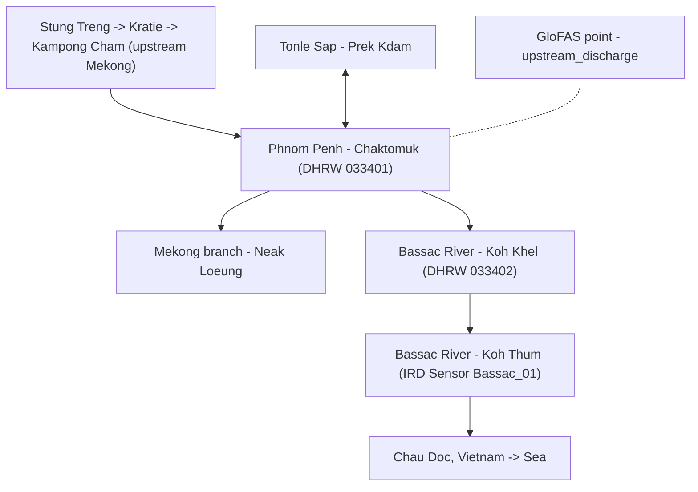

# Bassac River Water Level Forecasting — Learning Guide

> **Project in one sentence:**
> Predict **tomorrow's** water level of the Bassac River (Cambodia) using **past water levels**, **rainfall**, and **upstream river flow (`upstream_discharge`)**, now covering **both 2020–2024 (Koh Thum sensor) and 2020–2026 (DHRW Chaktomuk & Koh Khel stations)**.

---

## Part 0 — Project at a glance

| Question | Track A — Research Logger (`Bassac_01_ori.csv`) | Track B — Official DHRW Stations (`dhrw_water_level_2020_2026.csv`) |
|---|---|---|
| **Station** | Koh Thum, Kandal (lower Bassac) | **Koh Khel** & **Chaktomuk** (Bassac) + 5 upstream/Mekong stations |
| **Time range** | 20 Jun 2020 → 25 May 2024 | **17 Jun 2020 → 11 Nov 2026** (up to today!) |
| **Coverage** | Year-round (1,331 days) | **1,498 days**: flood season in 2020–2023 (647 days) + **year-round Jul 2024 – Nov 2026 (851 days)** |
| **Raw frequency** | Every 15 minutes → resampled to daily mean | Daily 07:00 AM official reading |
| **Inputs (X)** | Past water level + Kandal rainfall + `upstream_discharge` | Past water level + Kandal rainfall + `upstream_discharge` (+ optional upstream gauges: Kratie, Stung Treng, Kampong Cham) |
| **Target (y)** | Tomorrow's water level (`WL_next`, metres) | Tomorrow's water level (`WL_next`, metres) |

**Key purpose**
- Build a complete, honest ML forecasting workflow: collect → clean → merge → prevent leakage → train → evaluate → explain.
- Compare whether rainfall and upstream flow improve forecasts over a simple "tomorrow = today" baseline.

---

## Part 1 — The real-world problem

### 1.1 The river network
- The **Mekong** flows: China → Laos → Stung Treng → Kratie → Kampong Cham → Phnom Penh.
- At **Phnom Penh (Chaktomuk)** it splits into two branches: the Mekong mainstream and the **Bassac River** (western branch).
- The Bassac flows south through Kandal (**Chaktomuk → Koh Khel → Koh Thum**) into Vietnam.

**Why this matters:** Water passing Kratie, Kampong Cham, and Phnom Penh reaches Koh Khel and Koh Thum 1–3 days later, giving the model early warning before the flood wave arrives downstream.

### 1.2 Why the water level changes

| Season | Months | What happens | Koh Thum (`Bassac_01`) | Koh Khel / Chaktomuk (DHRW) |
|---|---|---|---|---|
| Dry | Dec – May | Little rain; sea tide pushes water up twice a day | ~1.3–1.8 m | ~1.4–3.5 m |
| Rising | Jun – Aug | Monsoon rain upstream; river swells | rises fast | rises fast |
| Peak | Sep – Oct | Maximum flood | ~4.5–5.3 m | ~6.5–8.7 m |
| Falling | Nov – Dec | Rain stops; water drains | drops | drops |

**Key idea**
- Most Bassac water comes from **upstream along the Mekong**, not local rain falling on Kandal alone.
- So **upstream flow (`upstream_discharge` or upstream station levels)** is a stronger predictor than local rainfall.

### 1.3 Why forecasting matters
- **Farmers** time rice planting and harvest around flood arrival and peak.
- **Early warning:** Predicting water height 1–7 days ahead helps communities prepare.
- **Changing river:** Upstream dams and climate shifts make historical averages less reliable, so data-driven ML models help.

---

## Part 2 — The four datasets in your folder

### 2.1 Dataset 1: Koh Thum research logger (`Bassac_01_ori.csv`) — TARGET (2020–2024)

| Item | Value |
|---|---|
| File | `Bassac_01_ori.csv` |
| Location | Bassac River at Koh Thum, Kandal (11.05 N, 105.07 E) |
| Recorded by | Institute of Technology of Cambodia (ITC) & IRD / UMR G-EAU (France) |
| Columns | `Date` (dd/mm/yyyy HH:MM), `WL` (m above sea level, Ha Tien datum) |
| Frequency | Every 15 minutes (127,605 rows) |
| Range | 19 Jun 2020 → 26 May 2024 (1,331 valid days, 107 missing days) |
| Source | Massuel, S. et al. (2024), DataSuds (IRD), https://doi.org/10.23708/E97HGV (CC-BY 4.0) |

### 2.2 Dataset 2: Official DHRW Daily Bulletins (`dhrw_water_level_2020_2026.csv`) — TARGET & UPSTREAM FEATURES (2020–2026)

| Item | Value |
|---|---|
| File | `dhrw_water_level_2020_2026.csv` |
| Recorded by | Department of Hydrology and River Works (DHRW), Ministry of Water Resources and Meteorology (MOWRAM), Cambodia |
| Source URL | https://dhrw-cam.org/bulletintbl.php |
| Frequency | Daily at 07:00 AM |
| Range | **17 Jun 2020 → 11 Nov 2026 (1,498 days, 0 missing values in table)** |
| Stations (7 columns) | **Bassac:** `Chaktomuk`, `Koh_Khel` · **Upstream Mekong:** `Stung_Treng`, `Kratie`, `Kampong_Cham` · **Lower Mekong:** `Neak_Loeung` · **Tonle Sap:** `Prek_Kdam` |

**Coverage by year in `dhrw_water_level_2020_2026.csv`:**

| Year | Days | Date Range | Season Coverage |
|---|---|---|---|
| 2020 | 161 | 2020-06-17 → 2020-11-24 | Flood season (Jun–Nov) |
| 2021 | 165 | 2021-06-09 → 2021-11-24 | Flood season (Jun–Nov) |
| 2022 | 161 | 2022-06-08 → 2022-11-30 | Flood season (Jun–Nov) |
| 2023 | 160 | 2023-06-19 → 2023-12-09 | Flood season (Jun–Dec) |
| **2024** | **182** | **2024-07-01 → 2024-12-31** | **Continuous (Jul–Dec)** |
| **2025** | **363** | **2025-01-01 → 2025-12-31** | **Full year-round (dry + wet)** |
| **2026** | **306** | **2026-01-01 → 2026-11-11** | **Full year-round (up to Nov 2026)** |

### 2.3 Dataset 3: Subnational Rainfall (`khm-rainfall-subnat-full.csv`) — FEATURE

| Item | Value |
|---|---|
| File | `khm-rainfall-subnat-full.csv` |
| Source | WFP / HDX (CHIRPS satellite + gauge rainfall), https://data.humdata.org/dataset/khm-rainfall-subnational |
| Frequency | **Dekad** = 10-day period (1st, 11th, 21st of each month) |
| Range | Jan 1981 → Oct 2026 |
| Filter used | `adm_level == 1`, `PCODE == "KH08"` (Kandal), `version != "prelim"` |
| Columns used | `rfh` (10-day rain mm), `r1h` (1-month rain mm), `r3h` (3-month rain mm), `rfq` (rain % of normal) |

### 2.4 Dataset 4: Upstream Discharge (`glofas_discharge_phnompenh.csv`) — FEATURE

| Item | Value |
|---|---|
| File | `glofas_discharge_phnompenh.csv` |
| Column | Raw `Q` → rename to `upstream_discharge` (m³/s = cubic metres of water flowing per second) |
| Location | Grid cell at Phnom Penh (11.525 N, 104.925 E), upstream of Koh Khel & Koh Thum |
| Range | 1 Jan 2018 → 9 Nov 2026 (3,235 daily rows) |
| Source | Copernicus GloFAS via Open-Meteo Flood API (modelled discharge, correlation 0.85 with Bassac WL) |

**What `upstream_discharge` (symbol Q) means in simple words**
- $1\text{ m}^3 \approx 1,000\text{ litres}$ (one large water tank).
- `upstream_discharge = 4,120` means ~4,120 tanks of water flow past Phnom Penh every second.
- Formula: $\text{Q} = \text{river cross-section area} \times \text{water speed}$.

---

## Part 3 — Choosing your time range (2020–2024 vs. 2024–2026)

### 3.1 Why you cannot simply paste DHRW numbers onto `Bassac_01_ori.csv`
They measure **different stations** with different zero-gauge references:

| Date | `Bassac_01` (Koh Thum) | `Koh_Khel` (DHRW) | `Chaktomuk` (DHRW) |
|---|---|---|---|
| 2022-08-10 | 3.67 m | 5.36 m | 5.85 m |
| 2022-10-01 | 5.29 m | 7.39 m | 8.69 m |
| 2023-09-20 | 4.98 m | 7.00 m | 8.05 m |

- Because the height difference changes between 1.1 m and 3.4 m depending on the flood level, pasting them into one column would create a fake jump in May 2024.

### 3.2 Three clean ways to use your datasets in the final project

| Option | Target Station | Date Range | Usable Daily Rows | Best For |
|---|---|---|---|---|
| **Option 1 (2020–2024)** | **Koh Thum** (`Bassac_01_ori.csv`) | Jun 2020 → May 2024 | ~1,323 days | Continuous 4-year sensor study from 15-min logger |
| **Option 2 (2020–2026)** | **Koh Khel or Chaktomuk** (`dhrw_water_level_2020_2026.csv`) | Jun 2020 → Oct 2026 | ~1,480 days (or **851 continuous days** Jul 2024 – Nov 2026) | **Includes 2024, 2025, and 2026** up to the present |
| **Option 3 (Both — Strongest Report)** | Train the same pipeline on **Koh Thum (2020–2024)** AND **Koh Khel / Chaktomuk (2024–2026)** | 2020 → 2026 | Both datasets | Proves your ML pipeline works across both historical (2020–2024) and recent (2024–2026) Bassac stations |

---

## Part 4 — Preparing the data

### 4.1 Align everything to daily resolution

| Dataset | Raw frequency | Action | Method | Why |
|---|---|---|---|---|
| `Bassac_01_ori.csv` | 15 min | **Downsample** | `resample("D").mean()` | Removes twice-daily tide noise; matches daily decisions |
| `dhrw_water_level_2020_2026.csv` | Daily (07:00) | None | Already 1 row per day | Official morning gauge reading |
| `khm-rainfall-subnat-full.csv` | 10 days (dekad) | **Upsample** | `rfh / days_in_dekad`, shift 1 dekad, `resample("D").ffill()` | Matches daily target without leaking future rain |
| `glofas_discharge_phnompenh.csv` | Daily | None | Rename `Q` → `upstream_discharge` | Already daily |

### 4.2 Prevent data leakage (cheating)
- **Rainfall leakage:** A dekad dated `2025-08-01` totals rain from Aug 1 to Aug 10. Shifting rainfall forward by **1 dekad** (`shift(1)`) ensures that on Aug 1 the model only sees the completed July 21–31 rain.
- **Target alignment:** Features use **today and earlier** (`t`, `t-1`, `t-2`, `t-3`); target is **tomorrow** (`WL_next = WL.shift(-1)`).

---

## Part 5 — Features (X) and Target (y)

| Column | Role | Meaning | Why include |
|---|---|---|---|
| `WL` | X | Today's water level | Strongest anchor for tomorrow's level |
| `WL_lag1`, `WL_lag2`, `WL_lag3` | X | Water level 1–3 days ago | Captures multi-day momentum |
| `WL_diff` | X | Today minus yesterday (`WL - WL_lag1`) | Shows how fast the river is rising or falling |
| `rf_daily`, `r1h`, `r3h`, `rfq` | X | Kandal rainfall (daily rate, 1m, 3m, % normal) | Local rain & soil wetness |
| `upstream_discharge_lag1` | X | Yesterday's GloFAS discharge at Phnom Penh | Upstream water volume heading toward Bassac |
| `upstream_discharge_diff` | X | Daily change in upstream discharge | Detects an incoming upstream flood wave |
| *(Bonus in DHRW Track)* `Kratie`, `Kampong_Cham` | X | Real upstream Mekong gauge levels | Measured flood wave 1–2 days upstream |
| `doy_sin`, `doy_cos` | X | Sine & cosine of day-of-year | Smooth circular calendar position |
| **`WL_next`** | **y** | **Tomorrow's Bassac water level (m)** | **What the model predicts** |

---

## Part 6 — Machine learning workflow

### 6.1 Time-based Train / Test Split (never shuffle!)
- **For Koh Thum (2020–2024):**
  - **Train:** Jun 2020 – Dec 2022 (~61%, 3 monsoons)
  - **Test:** Jan 2023 – May 2024 (~39%, full 2023 monsoon + dry season)
- **For DHRW Koh Khel / Chaktomuk (2020–2026):**
  - **Train:** Jun 2020 – Dec 2024 (5 monsoons + late-2024 dry transition)
  - **Test:** Jan 2025 – Oct 2026 (**full 2025 and 2026 years**, unseen future test)

### 6.2 Models to compare
1. **Naive Baseline (`WL_next = WL`):** Guessing "tomorrow = today". Every ML model must beat this to be useful.
2. **Ridge Regression:** Linear formula with $L_2$ penalty; best at smooth, continuous water-level trends.
3. **Random Forest** *(trained on daily change $\Delta \text{WL} = \text{WL}_{t+1} - \text{WL}_t$)*: Ensemble of decision trees voting on how much the river will rise or fall tomorrow.
4. **XGBoost** *(trained on daily change $\Delta \text{WL}$)*: Gradient-boosted trees fixing previous trees' errors step by step.

### 6.3 Evaluation metrics
- **MAE (Mean Absolute Error, m):** Average daily miss in metres (e.g., `0.030 m` = 3 cm average error).
- **RMSE (Root Mean Squared Error, m):** Squares errors before averaging, punishing large flood-peak misses harder.
- **$R^2$ Score:** Share of variance explained (close to `1.0`). Always report **MAE Skill vs. Naive Baseline (%)** alongside $R^2$.

---

## Part 7 — Limitations to state in your report

1. **Station datum difference:** Koh Thum (`Bassac_01_ori.csv`) and DHRW stations (`Koh_Khel`, `Chaktomuk`) sit at different points along the Bassac with different zero-gauge heights, so they are modelled as separate tracks rather than concatenated into a single column.
2. **DHRW 2020–2023 dry season:** DHRW published flood-season bulletins (Jun–Nov) in 2020–2023 before switching to full year-round daily reporting in July 2024 – November 2026.
3. **Dekadal rainfall resolution:** Rainfall is recorded every 10 days and forward-filled to daily (lagged by 1 dekad to prevent look-ahead leakage).
4. **Modelled discharge:** `upstream_discharge` comes from the Copernicus GloFAS simulation rather than an in-river flow meter (though `dhrw_water_level_2020_2026.csv` also provides real upstream gauges at Kratie and Kampong Cham).

---

## References

1. Massuel, S. et al. (2024). *Water Level Data from the Prek System of the Cambodian Mekong Delta (2020–2024)*. DataSuds, IRD. https://doi.org/10.23708/E97HGV
2. Department of Hydrology and River Works (DHRW), MOWRAM Cambodia. *Daily River Water Level Bulletin (2020–2026)*. https://dhrw-cam.org/bulletintbl.php
3. WFP / Humanitarian Data Exchange (HDX). *Cambodia: Rainfall Indicators at Subnational Level (CHIRPS)*. https://data.humdata.org/dataset/khm-rainfall-subnational
4. Copernicus EMS / Open-Meteo. *Global Flood Awareness System (GloFAS) River Discharge API*. https://open-meteo.com/en/docs/flood-api
